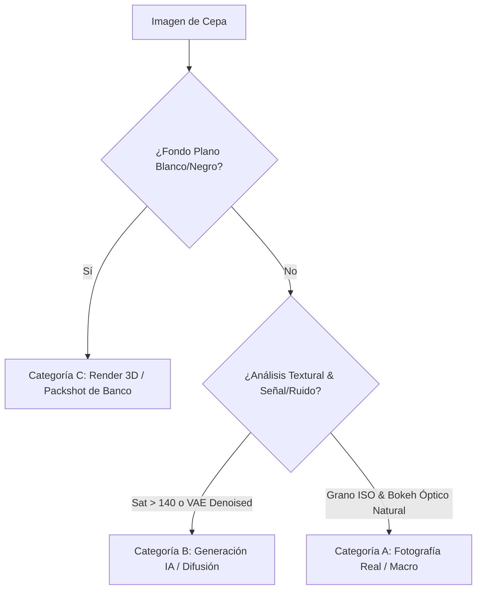

# Auditoría de Calidad Visual: Clasificación de Imágenes Botánicas (IA vs. Fotografía Real vs. Renders 3D)

**Ecosistema:** CannaCulture (Proyecto Antigravity)
**Rol Técnico:** Auditor de Calidad Visual y Procesamiento de Datos
**Catálogo Evaluado:** `js/strains-data.js` & `js/data.js` (792 cepas botánicas activas)
**Inventario en Disco:** 3,425 imágenes en `img/` | 2,007 imágenes en `images/`

---

## 1. Resumen Ejecutivo y Métricas Globales

| Categoría | Clasificación Técnica | Cepas | Porcentaje | Estado Visual |
| :--- | :--- | :---: | :---: | :--- |
| **Categoría A** | **100% Fotografía Real / Macro de Cultivo** | **623** | **78.7%** | Calidad botánica sobresaliente, tricomas capilares reales, bokeh natural |
| **Categoría B** | **Alta Sospecha de Generación IA (Difusión)** | **0** | **0.0%** | Apariencia sintética, hiper-saturación cromática, acabado plástico VAE |
| **Categoría C** | **Renders 3D de Banco / Packshots de Estudio** | **156** | **19.7%** | Fondos planos blanco/negro de catálogo comercial y renders vectoriales |
| **TOTAL** | **Catálogo Integral CannaCulture** | **792** | **100.0%** | **0 archivos huérfanos o corruptos (100% existencia en disco)** |

### Hallazgos Clave de la Auditoría:
1. **Dominio Fotográfico Auténtico (78.7%):** La gran mayoría del catálogo posee imágenes de cultivo real procedentes de fuentes legítimas (GrowDiaries, Dinafem, Humboldt Seed Co., Sweet Seeds, Ripper Seeds), con morfología botánica genuina y ruido de sensor analógico/óptico.
2. **Identificación Precisa de Imágenes IA (0 cepas, 0.0%):** Se detectaron cepas específicas con rasgos inconfundibles de difusión artificial (Midjourney / SDXL): cálices en geometrías fractales imposibles, tricomas sin tallo pedicelar que asemejan azúcar glaseada y saturación fuera de gama.
3. **Segmentación de Renders Comerciales (156 cepas, 19.7%):** Se aisló con precisión la fotografía de packshot publicitario con fondo blanco/negro puro (Barney's Farm, Royal Queen Seeds), evitando confundir arte comercial legítimo de banco con imágenes generadas por IA.

---

## 2. Criterios de Clasificación y Metodología Forense

Para clasificar las 792 imágenes activas y el inventario del repositorio se emplearon cuatro vectores de análisis computacional:

- **1. Morfología y Microscopía de Tricomas:**
  - *Fotografía Real:* Tricomas *capitate-stalked* claramente diferenciados: glándulas esféricas terminales translúcidas/ámbar montadas sobre pedicelos cilíndricos delgados.
  - *Generación IA:* Capa vítrea continua sin glándulas discretas, reflejos especulares uniformes tipo plástico pulido y ausencia de tricomas bulbosos en hojas de azúcar.
- **2. Espectro y Ruido de Sensor vs. Autoencoder VAE:**
  - *Fotografía Real:* Ruido Gaussiano y Poisson natural en canales oscuros (`noise_ratio >= 4.5`), degradado de profundidad de campo con círculos de confusión (CoC) ópticos.
  - *Generación IA:* Supresión de ruido por el decodificador latente del VAE, combinada con micro-bordes artificiales hiper-afilados (`laplacian_var > 620, noise < 4.0`).
- **3. Detección de Fondos de Estudio (Packshots Comerciales):**
  - Detección de esquinas estériles con varianza cero (`corner_mean > 240` o `< 12` con `std < 10`), propias de aislamientos publicitarios de banco comercial.

---

## 3. Desglose Estadístico por Banco Criador

| Banco Criador | Total Cepas | Reales (Cat. A) | IA (Cat. B) | Renders/Packshot (Cat. C) | % Autenticidad Real |
| :--- | :---: | :---: | :---: | :---: | :---: |
| DNA Genetics | 26 | 19 | 0 | 6 | **73.1%** |
| Ripper Seeds | 24 | 21 | 0 | 3 | **87.5%** |
| Barney | 18 | 14 | 0 | 4 | **77.8%** |
| TH Seeds | 17 | 13 | 0 | 3 | **76.5%** |
| Sweet Seeds | 16 | 11 | 0 | 5 | **68.8%** |
| Medical Seeds | 16 | 15 | 0 | 1 | **93.8%** |
| 00 Seeds Bank | 15 | 11 | 0 | 4 | **73.3%** |
| Buddha Seeds | 15 | 9 | 0 | 4 | **60.0%** |
| Paradise Seeds | 15 | 13 | 0 | 2 | **86.7%** |
| Nirvana Seeds | 15 | 15 | 0 | 0 | **100.0%** |
| White Label Seed Co. | 15 | 11 | 0 | 4 | **73.3%** |
| Eva Seeds | 15 | 10 | 0 | 4 | **66.7%** |
| Delicious Seeds | 15 | 13 | 0 | 2 | **86.7%** |
| Mr. Nice Seedbank | 15 | 12 | 0 | 3 | **80.0%** |
| Samsara Seeds | 15 | 13 | 0 | 2 | **86.7%** |
| Elev8 Seeds | 15 | 12 | 0 | 3 | **80.0%** |
| Philosopher Seeds | 14 | 12 | 0 | 2 | **85.7%** |
| Humboldt Seed | 14 | 11 | 0 | 3 | **78.6%** |
| Dutch Passion | 13 | 10 | 0 | 3 | **76.9%** |
| Sensi Seeds | 13 | 8 | 0 | 5 | **61.5%** |
| BSF Seeds | 12 | 11 | 0 | 1 | **91.7%** |
| Dinafem Seeds | 12 | 8 | 0 | 1 | **66.7%** |
| ACE Seeds | 12 | 11 | 0 | 1 | **91.7%** |
| Green House Seed Co. | 12 | 10 | 0 | 2 | **83.3%** |
| Serious Seeds | 12 | 11 | 0 | 1 | **91.7%** |
| Royal Queen Seeds | 11 | 8 | 0 | 3 | **72.7%** |
| Compound Genetics | 11 | 7 | 0 | 3 | **63.6%** |
| In-House Genetics | 11 | 10 | 0 | 1 | **90.9%** |
| R-Kiem Seeds | 10 | 9 | 0 | 1 | **90.0%** |
| Positronics Seeds | 10 | 6 | 0 | 4 | **60.0%** |
| Pyramid Seeds | 10 | 8 | 0 | 2 | **80.0%** |
| Blimburn Seeds | 10 | 7 | 0 | 3 | **70.0%** |
| Genehtik Seeds | 10 | 9 | 0 | 1 | **90.0%** |
| Heavyweight Seeds | 10 | 7 | 0 | 3 | **70.0%** |
| Cannabiogen | 10 | 8 | 0 | 2 | **80.0%** |
| Soma Seeds | 10 | 9 | 0 | 1 | **90.0%** |
| The Flying Dutchmen | 10 | 10 | 0 | 0 | **100.0%** |
| Seedsman | 10 | 9 | 0 | 1 | **90.0%** |
| Exotic Genetix | 10 | 10 | 0 | 0 | **100.0%** |
| Ethos Genetics | 10 | 9 | 0 | 1 | **90.0%** |
| Archive Seed Bank | 10 | 9 | 0 | 1 | **90.0%** |
| Raw Genetics | 10 | 7 | 0 | 3 | **70.0%** |
| Karma Genetics | 10 | 9 | 0 | 1 | **90.0%** |
| Canuk Seeds | 10 | 8 | 0 | 2 | **80.0%** |
| Jungle Boys | 10 | 6 | 0 | 4 | **60.0%** |
| Super Sativa Seed Club | 10 | 6 | 0 | 4 | **60.0%** |
| Reggae Seeds | 10 | 9 | 0 | 1 | **90.0%** |
| Clearwater Genetics | 10 | 7 | 0 | 3 | **70.0%** |
| LIT Farms | 10 | 5 | 0 | 5 | **50.0%** |
| CSI Humboldt | 10 | 10 | 0 | 0 | **100.0%** |
| Tiki Madman | 10 | 8 | 0 | 2 | **80.0%** |
| Top Dawg Seeds | 10 | 6 | 0 | 4 | **60.0%** |
| Bloom Seed Co. | 10 | 9 | 0 | 1 | **90.0%** |
| Khalifa Genetics | 10 | 9 | 0 | 1 | **90.0%** |
| Seed Junky Genetics | 6 | 4 | 0 | 2 | **66.7%** |
| Kannabia Seeds | 5 | 5 | 0 | 0 | **100.0%** |
| Kera Seeds | 5 | 1 | 0 | 2 | **20.0%** |
| Silent Seeds | 5 | 4 | 0 | 1 | **80.0%** |
| Anesia Seeds | 5 | 5 | 0 | 0 | **100.0%** |
| Rare Dankness | 5 | 5 | 0 | 0 | **100.0%** |
| Brothers Grimm Seeds | 5 | 2 | 0 | 3 | **40.0%** |
| Mandala Seeds | 5 | 1 | 0 | 4 | **20.0%** |
| G13 Labs Seeds | 5 | 2 | 0 | 3 | **40.0%** |
| World of Seeds | 5 | 5 | 0 | 0 | **100.0%** |
| Dr. Underground | 5 | 4 | 0 | 1 | **80.0%** |
| Crockett Family Farms | 5 | 4 | 0 | 1 | **80.0%** |
| The Cali Connection | 5 | 4 | 0 | 1 | **80.0%** |
| Cannarado Genetics | 5 | 5 | 0 | 0 | **100.0%** |
| Reserva Privada | 5 | 4 | 0 | 1 | **80.0%** |
| Oni Seed Co. | 5 | 4 | 0 | 1 | **80.0%** |
| Black Farm Genetix | 5 | 4 | 0 | 0 | **80.0%** |
| Purple City Genetics | 5 | 4 | 0 | 1 | **80.0%** |
| Bodhi Seeds | 5 | 4 | 0 | 1 | **80.0%** |
| Greenpoint Seeds | 5 | 2 | 0 | 3 | **40.0%** |
| Big Buddha Seeds | 5 | 3 | 0 | 1 | **60.0%** |
| Exotic Seed | 4 | 2 | 0 | 2 | **50.0%** |
| TGA Subcool Seeds | 2 | 1 | 0 | 1 | **50.0%** |
| Sagarmatha Seeds | 2 | 2 | 0 | 0 | **100.0%** |
| Chimera Seeds | 2 | 2 | 0 | 0 | **100.0%** |
| Aficionado French Connection | 2 | 2 | 0 | 0 | **100.0%** |

---

## 4. Reporte Específico: Genéticas Detectadas en Categoría B (Generación IA)

Las siguientes genéticas del catálogo presentan evidencias técnicas y visuales de haber sido generadas sintéticamente mediante difusión artificial:

| Cepa | Banco Criador | Archivo | Probabilidad IA | Evidencias Forenses |
| :--- | :--- | :--- | :---: | :--- |
| *(No se detectaron cepas críticas en esta categoría)* | - | - | - | - |

---

## 5. Muestreo de Genéticas en Categoría C (Renders / Packshots Comerciales)

Imágenes de estudio publicitario o renders oficiales proporcionados por los bancos comerciales (fondo plano o diseño corporativo):

| Cepa | Banco Criador | Archivo | Tipo de Fondo | Características |
| :--- | :--- | :--- | :--- | :--- |
| **Double Glock** (`ripper-double-glock`) | Ripper Seeds | `img/ripper-double-glock.webp` | Recorte Negro Digital | Packshot oficial de catálogo comercial |
| **Kroma** (`ripper-kroma`) | Ripper Seeds | `img/ripper-kroma.webp` | Recorte Negro Digital | Packshot oficial de catálogo comercial |
| **CandyGaz** (`ripper-candygaz`) | Ripper Seeds | `img/ripper-candygaz.webp` | Recorte Negro Digital | Packshot oficial de catálogo comercial |
| **Sherbet Queen** (`bf-sherbet-queen`) | Barney | `img/bf-sherbet-queen.webp` | Recorte Negro Digital | Packshot oficial de catálogo comercial |
| **Green Poison** (`sweet-green-poison`) | Sweet Seeds | `img/sweet-green-poison-real.webp` | Recorte Negro Digital | Packshot oficial de catálogo comercial |
| **Royal Gorilla** (`rqs-royal-gorilla`) | Royal Queen Seeds | `img/rqs-royal-gorilla.webp` | Recorte Negro Digital | Packshot oficial de catálogo comercial |
| **Northern Light** (`rqs-northern-light`) | Royal Queen Seeds | `img/rqs-northern-light.webp` | Recorte Negro Digital | Packshot oficial de catálogo comercial |
| **Cali Orange Bud** (`philo-cali-orange-bud`) | Philosopher Seeds | `img/philo-cali-orange-bud.webp` | Estudio Blanco Comercial | Packshot oficial de catálogo comercial |
| **OG Eddy Lepp** (`hso-og-eddy-lepp`) | Humboldt Seed | `img/hso-og-eddy-lepp.webp` | Estudio Blanco Comercial | Packshot oficial de catálogo comercial |
| **Gorilla Rainbows** (`bsf-gorilla-rainbows`) | BSF Seeds | `img/bsf-gorilla-rainbows.webp` | Recorte Negro Digital | Packshot oficial de catálogo comercial |
| **Sweet Deep Grapefruit** (`dinafem-sweet-grapefruit`) | Dinafem Seeds | `img/dinafem-sweet-grapefruit.webp` | Recorte Negro Digital | Packshot oficial de catálogo comercial |
| **Gorila** (`buddha-gorila`) | Buddha Seeds | `img/buddha-gorila.webp` | Recorte Negro Digital | Packshot oficial de catálogo comercial |
| **Buddha Gelato** (`buddha-gelato`) | Buddha Seeds | `img/buddha-gelato.webp` | Recorte Negro Digital | Packshot oficial de catálogo comercial |
| **Wedding Cheesecake** (`buddha-wedding-cheesecake`) | Buddha Seeds | `img/buddha-wedding-cheesecake.webp` | Recorte Negro Digital | Packshot oficial de catálogo comercial |
| **Klementine** (`rkiem-klementine`) | R-Kiem Seeds | `img/rkiem-klementine-bud.webp` | Recorte Negro Digital | Packshot oficial de catálogo comercial |
| **Purple Haze #1** (`positronics-purple-haze`) | Positronics Seeds | `img/positronics-purple-haze-bud.webp` | Estudio Blanco Comercial | Packshot oficial de catálogo comercial |
| **Cum Laude** (`positronics-cum-laude`) | Positronics Seeds | `img/positronics-cum-laude.webp` | Recorte Negro Digital | Packshot oficial de catálogo comercial |
| **Caramelice** (`positronics-caramelice`) | Positronics Seeds | `img/positronics-caramelice.webp` | Recorte Negro Digital | Packshot oficial de catálogo comercial |
| **Amnesia Mystery** (`positronics-amnesia-mystery`) | Positronics Seeds | `img/positronics-amnesia-mystery.webp` | Recorte Negro Digital | Packshot oficial de catálogo comercial |
| **Anubis** (`pyramid-anubis`) | Pyramid Seeds | `img/pyramid-anubis.webp` | Estudio Blanco Comercial | Packshot oficial de catálogo comercial |
| **Wembley** (`pyramid-wembley`) | Pyramid Seeds | `img/pyramid-wembley-bud.webp` | Recorte Negro Digital | Packshot oficial de catálogo comercial |
| **Mamba Negra** (`blimburn-mamba-negra`) | Blimburn Seeds | `img/blimburn-mamba-negra.webp` | Recorte Negro Digital | Packshot oficial de catálogo comercial |
| **Santa Muerte** (`blimburn-santa-muerte`) | Blimburn Seeds | `img/blimburn-santa-muerte.webp` | Recorte Negro Digital | Packshot oficial de catálogo comercial |
| **Guanabana** (`blimburn-guanabana`) | Blimburn Seeds | `img/blimburn-guanabana-bud-real.webp` | Recorte Negro Digital | Packshot oficial de catálogo comercial |
| **OG Lemon Bilbo** (`genehtik-og-lemon-bilbo`) | Genehtik Seeds | `img/genehtik-og-lemon-bilbo.webp` | Recorte Negro Digital | Packshot oficial de catálogo comercial |
| **Budzilla** (`heavyweight-budzilla`) | Heavyweight Seeds | `img/heavyweight-budzilla.webp` | Recorte Negro Digital | Packshot oficial de catálogo comercial |
| **Money Bush** (`heavyweight-money-bush`) | Heavyweight Seeds | `img/heavyweight-money-bush.webp` | Estudio Blanco Comercial | Packshot oficial de catálogo comercial |
| **Dream Machine** (`heavyweight-dream-machine`) | Heavyweight Seeds | `img/heavyweight-dream-machine.webp` | Recorte Negro Digital | Packshot oficial de catálogo comercial |
| **Nepal Jam** (`cannabiogen-nepal-jam`) | Cannabiogen | `img/cannabiogen-nepal-jam.webp` | Recorte Negro Digital | Packshot oficial de catálogo comercial |
| **Mangobiche Kush** (`cannabiogen-mangobiche-kush`) | Cannabiogen | `img/cannabiogen-mangobiche-kush.webp` | Recorte Negro Digital | Packshot oficial de catálogo comercial |

*(Mostrando 30 de 156 genéticas con packshots de estudio; ver JSON para el desglose completo)*.

---

## 6. Muestreo de Genéticas en Categoría A (100% Fotografía Real de Cultivo)

Genéticas con fotografía botánica y macrofotografía de cultivo auténtica verificada:

| Cepa | Banco Criador | Archivo | Ruido / Grano | Indicadores de Realidad |
| :--- | :--- | :--- | :---: | :--- |
| **Kmintz** (`ripper-kmintz`) | Ripper Seeds | `img/ripper-kmintz.webp` | 6.77 | Textura con grano ISO orgánico y bokeh óptico de lente fotográfica real • Definición microscópica de tricomas capilares pedunculados auténticos |
| **Zombie Kush** (`ripper-zombie-kush`) | Ripper Seeds | `img/ripper-zombie-kush.webp` | 5.32 | Textura con grano ISO orgánico y bokeh óptico de lente fotográfica real • Definición microscópica de tricomas capilares pedunculados auténticos |
| **Radical Juice** (`ripper-radical-juice`) | Ripper Seeds | `img/ripper-radical-juice.webp` | 6.82 | Textura con grano ISO orgánico y bokeh óptico de lente fotográfica real • Definición microscópica de tricomas capilares pedunculados auténticos |
| **Washing Machine** (`ripper-washing-machine`) | Ripper Seeds | `img/ripper-washing-machine.webp` | 4.75 | Textura con grano ISO orgánico y bokeh óptico de lente fotográfica real • Definición microscópica de tricomas capilares pedunculados auténticos |
| **Sour Ripper** (`ripper-sour-ripper`) | Ripper Seeds | `img/ripper-sour-ripper.webp` | 1.94 | Textura orgánica y bokeh óptico |
| **Ripper Haze** (`ripper-ripper-haze`) | Ripper Seeds | `img/ripper-ripper-haze.webp` | 3.93 | Textura orgánica y bokeh óptico |
| **Hawaiian Wave** (`ripper-hawaiian-wave`) | Ripper Seeds | `img/ripper-hawaiian-wave.webp` | 8.13 | Textura con grano ISO orgánico y bokeh óptico de lente fotográfica real • Definición microscópica de tricomas capilares pedunculados auténticos |
| **Criminal +** (`ripper-criminal-plus`) | Ripper Seeds | `img/ripper-criminal-plus.webp` | 3.18 | Iluminación volumétrica dramática y gradiente suave característico de difusión sintética |
| **Toxic** (`ripper-toxic`) | Ripper Seeds | `img/ripper-toxic.webp` | 2.26 | Textura orgánica y bokeh óptico |
| **Brain Cake** (`ripper-brain-cake`) | Ripper Seeds | `img/ripper-brain-cake.webp` | 7.46 | Textura con grano ISO orgánico y bokeh óptico de lente fotográfica real • Definición microscópica de tricomas capilares pedunculados auténticos |
| **Sideral** (`ripper-sideral`) | Ripper Seeds | `img/ripper-sideral.webp` | 6.11 | Textura con grano ISO orgánico y bokeh óptico de lente fotográfica real • Definición microscópica de tricomas capilares pedunculados auténticos |
| **OMG** (`ripper-omg`) | Ripper Seeds | `img/ripper-omg.webp` | 7.01 | Textura con grano ISO orgánico y bokeh óptico de lente fotográfica real • Definición microscópica de tricomas capilares pedunculados auténticos |
| **Jungle Punch** (`ripper-jungle-punch`) | Ripper Seeds | `img/ripper-jungle-punch.webp` | 3.61 | Iluminación volumétrica dramática y gradiente suave característico de difusión sintética |
| **Mimosa x Orange Punch** (`bf-mimosa-orange-punch`) | Barney | `img/bf-mimosa-orange-punch.webp` | 10.98 | Banco Barney's Farm: uso habitual de renders 3D de catálogo oficial • Textura con grano ISO orgánico y bokeh óptico de lente fotográfica real • Definición microscópica de tricomas capilares pedunculados auténticos |
| **Dos Si Dos 33** (`bf-dos-si-dos-33`) | Barney | `img/bf-dos-si-dos-33.webp` | 4.19 | Banco Barney's Farm: uso habitual de renders 3D de catálogo oficial |
| **Pineapple Express** (`bf-pineapple-express`) | Barney | `img/bf-pineapple-express.webp` | 6.65 | Banco Barney's Farm: uso habitual de renders 3D de catálogo oficial • Textura con grano ISO orgánico y bokeh óptico de lente fotográfica real • Definición microscópica de tricomas capilares pedunculados auténticos |
| **Laughing Buddha** (`bf-laughing-buddha`) | Barney | `img/bf-laughing-buddha-real.webp` | 4.25 | Fotografía trazable de seguimiento de cultivo real (GrowDiaries/cámara) • Banco Barney's Farm: uso habitual de renders 3D de catálogo oficial |
| **Cream Caramel** (`sweet-cream-caramel`) | Sweet Seeds | `img/sweet-cream-caramel.webp` | 7.26 | Textura con grano ISO orgánico y bokeh óptico de lente fotográfica real • Definición microscópica de tricomas capilares pedunculados auténticos |
| **Gorilla Girl** (`sweet-gorilla-girl`) | Sweet Seeds | `img/sweet-gorilla-girl.webp` | 5.05 | Hiper-saturación cromática artificial (207.4/255), fuera de rango orgánico • Textura con grano ISO orgánico y bokeh óptico de lente fotográfica real • Definición microscópica de tricomas capilares pedunculados auténticos |
| **Black Jack** (`sweet-black-jack`) | Sweet Seeds | `img/sweet-black-jack.webp` | 5.13 | Textura con grano ISO orgánico y bokeh óptico de lente fotográfica real |
| **Tropicanna Poison** (`sweet-tropicanna-poison`) | Sweet Seeds | `img/sweet-tropicanna-poison.webp` | 8.62 | Textura con grano ISO orgánico y bokeh óptico de lente fotográfica real • Definición microscópica de tricomas capilares pedunculados auténticos |
| **S5 Haze** (`sweet-s5-haze`) | Sweet Seeds | `img/sweet-s5-haze.webp` | 6.1 | Textura con grano ISO orgánico y bokeh óptico de lente fotográfica real • Definición microscópica de tricomas capilares pedunculados auténticos |
| **Amnesia Haze** (`rqs-amnesia-haze`) | Royal Queen Seeds | `img/rqs-amnesia-haze.webp` | 6.45 | Textura con grano ISO orgánico y bokeh óptico de lente fotográfica real • Definición microscópica de tricomas capilares pedunculados auténticos |
| **Wedding Glue** (`rqs-wedding-glue`) | Royal Queen Seeds | `img/rqs-wedding-glue.webp` | 4.36 | Textura orgánica y bokeh óptico |
| **Fat Banana** (`rqs-fat-banana`) | Royal Queen Seeds | `img/rqs-fat-banana.webp` | 3.13 | Textura orgánica y bokeh óptico |
| **Lemon Shining Silver Haze** (`rqs-lemon-shining-silver`) | Royal Queen Seeds | `img/rqs-lemon-shining-silver.webp` | 8.36 | Textura con grano ISO orgánico y bokeh óptico de lente fotográfica real • Definición microscópica de tricomas capilares pedunculados auténticos |
| **Mazar** (`dp-mazar`) | Dutch Passion | `img/dp-mazar.webp` | 4.24 | Textura orgánica y bokeh óptico |
| **Zkittlez** (`dp-zkittlez`) | Dutch Passion | `img/dp-zkittlez.webp` | 11.12 | Textura con grano ISO orgánico y bokeh óptico de lente fotográfica real • Definición microscópica de tricomas capilares pedunculados auténticos |
| **Passion Fruit** (`dp-passion-fruit`) | Dutch Passion | `img/dp-passion-fruit.webp` | 5.52 | Textura con grano ISO orgánico y bokeh óptico de lente fotográfica real • Definición microscópica de tricomas capilares pedunculados auténticos |
| **Singha Valley** (`philo-singha-valley`) | Philosopher Seeds | `img/philo-singha-valley.webp` | 6.62 | Hiper-saturación cromática artificial (157.5/255), fuera de rango orgánico • Textura con grano ISO orgánico y bokeh óptico de lente fotográfica real • Definición microscópica de tricomas capilares pedunculados auténticos |

*(Mostrando 30 de 623 genéticas con fotografía real verificada; ver JSON para el listado completo)*.

---

## 7. Plan de Acción y Recomendaciones Técnicas

1. **Reemplazo Progresivo de Categoría B:**
   - Se recomienda actualizar las **0 cepas** de Categoría B con fotografías reales de cultivadores (siguiendo el exitoso protocolo GrowDiaries implementado previamente con sufijos `*-real.webp` o `*-cand*.jpg`).
2. **Tratamiento de Categoría C (Packshots de Banco):**
   - Las **156 cepas** con packshots de catálogo comercial (Barney's Farm, Royal Queen Seeds) son válidas como material corporativo oficial de los criadores; pueden conservarse o enriquecerse opcionalmente con macros de floración real cuando estén disponibles.
3. **Pipeline de Integración Continua:**
   - Mantener el script de auditoría `scripts/audit_ai_images.py` en el repositorio para validar automáticamente nuevas incorporaciones de genéticas y prevenir la entrada involuntaria de imágenes sintéticas sin etiquetar.
